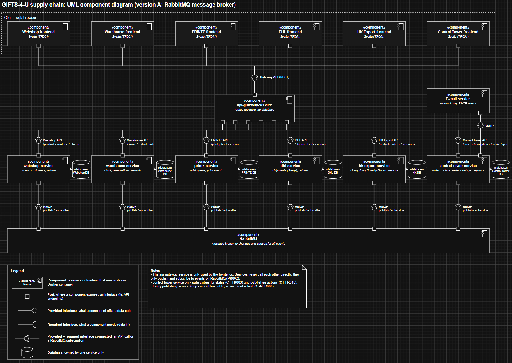
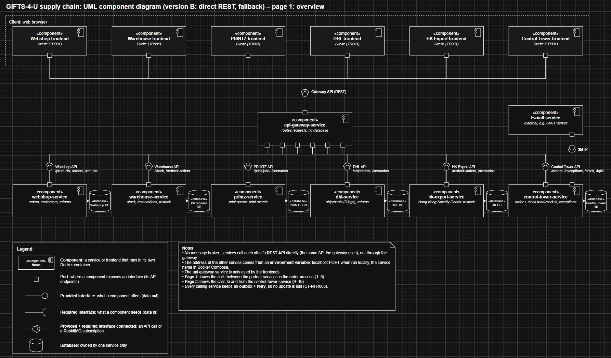
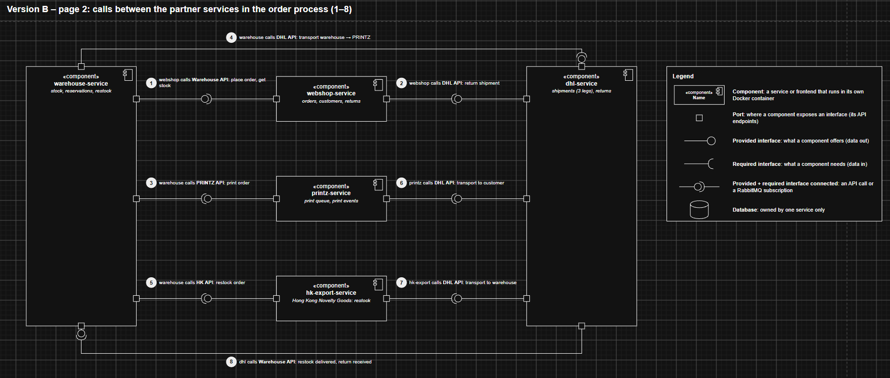
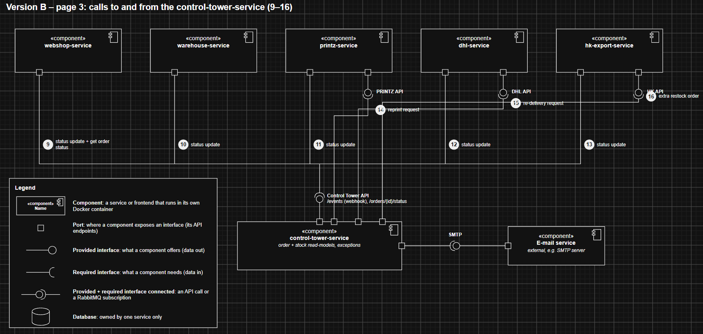

# UML Component Diagram

This document describes the microservice architecture of the GIFTS-4-U supply chain system in two versions:

- **Version A – RabbitMQ message broker** (planned): services communicate through events on RabbitMQ (PR002).
- **Version B – Direct REST** (fallback): if the message broker does not work out, services call each other's REST APIs directly.

Both versions are based on the Projectplan, `Requirements.md`, the ERD (one database per service, outbox pattern) and the Level 1/2 DFD. There is no code yet, so this is the **target architecture**.

Editable draw.io sources:

- [`component-diagram-message-broker.drawio`](images/component-diagram-message-broker.drawio)
- [`component-diagram-rest.drawio`](images/component-diagram-rest.drawio) (3 pages)

## Notation

| Symbol | Meaning |
|---|---|
| Box with «component», name and component icon | **Component**: a logical unit that runs in its own Docker container (PR001, TR004) |
| Small square on the edge of a component | **Port**: where the component exposes an interface. For our microservices these are the API endpoints |
| Ball (circle) on a line | **Provided interface**: what a component offers to other components (data out) |
| Socket (half circle) on a line | **Required interface**: what a component needs from another component (data in) |
| Ball inside a socket | The required and provided interface are **connected** (an API call or a RabbitMQ subscription) |
| Cylinder | **«database»**, owned by exactly one service (PR003, TR002/TR003) |
| Dashed box | The **web browser** in which all Svelte frontends run (PR004, TR001) |

The interface labels show **example endpoints**. The final endpoints and event contracts come from the API Message Design (TR005).

## Components (same in both versions)

The service names match the folders in the code.

| Component | Responsibility | Database | Main requirements |
|---|---|---|---|
| Webshop frontend + `webshop-service` | Product catalogue, personalisation, orders, payments (simulated), returns, order status for customers | Webshop DB | Webshop FR001–FR017, DFD 1.0 |
| Warehouse frontend + `warehouse-service` | Automatic stock, reservations, print orders, restock orders, returns | Warehouse DB | Warehouse FR001–FR016, DFD 2.0 |
| PRINTZ frontend + `printz-service` | Print queue, print events, machine breakdown scenarios, reprints | PRINTZ DB | PRINTZ FR001–FR011 |
| DHL frontend + `dhl-service` | Shipments for three legs, shipment events and exceptions, returns, re-deliveries | DHL DB | DHL FR001–FR012 |
| HK Export frontend + `hk-export-service` (Hong Kong Novelty Goods) | Restock orders, expected delivery dates, dispatch delays | HK DB | HK Export FR001–FR008 |
| Control Tower frontend + `control-tower-service` | Live order overview, exceptions, timeline, stock risks, notifications, actions | Control Tower DB | Control Tower FR001–FR035, DFD 3.0 |
| `api-gateway-service` | Single entry point for all frontends; routes requests to the right service; no database (ERD) | – | Webshop TR003 |
| E-mail service (external) | Sends flag e-mails and B2B priority e-mails over SMTP | – | Control Tower FR017, FR019 |

Every service has its own REST API (provided interface, on a port) that the `api-gateway-service` requires to serve the frontends. Every service that publishes events keeps an **outbox table** in its own database, so events are not lost when the broker or another service is down (NFR006, ERD).

---

## Version A – RabbitMQ message broker

**How it works**

- Frontends only talk to the **API Gateway**, which forwards each request to the right service's API.
- Services never call each other directly. They **publish** events to RabbitMQ and **subscribe** to the events they need. RabbitMQ is the only connection between the services.
- The **Control Tower** subscribes to all status events and builds its own read-model (TR003, FR001–FR016). It also publishes **action events**, such as a reprint request, that the partner services pick up (FR018).
- **RabbitMQ** provides one interface to every service: **AMQP** (publish / subscribe). Each service has a port for it; in the diagram that is the ball-and-socket pair between each service and RabbitMQ.

**Main events (draft; final names and fields follow the API Message Design, TR005)**

| Event | Publisher | Subscribers | Requirements |
|---|---|---|---|
| Order received | Webshop | Warehouse, Control Tower | Webshop FR004, CT FR003 |
| Stock reserved / out of stock / stock changed | Warehouse | Webshop, Control Tower | Warehouse FR002, FR003; Webshop NFR001; CT FR011, FR016 |
| Print order requested | Warehouse | PRINTZ | Warehouse FR004 |
| Transport requested | Warehouse, PRINTZ, HK, Webshop (returns) | DHL | DHL FR001, PRINTZ FR003, HK FR003 |
| Restock ordered | Warehouse | Hong Kong Novelty Goods, Control Tower | Warehouse FR007, CT FR013 |
| Printing started / printed / ready to ship / print delayed | PRINTZ | Control Tower, Webshop | PRINTZ FR002, FR005; CT FR014 |
| Picked up / in transit / delivered / shipment delayed | DHL | Control Tower, Webshop, Warehouse | DHL FR004, FR007; CT FR015; Warehouse FR005 |
| Restock confirmed / dispatched / dispatch delayed | Hong Kong Novelty Goods | Control Tower, Warehouse | HK FR002, FR004; CT FR013 |
| Return requested | Webshop | DHL, Warehouse, Control Tower | Webshop FR012, CT FR007 |
| Reprint / re-delivery / extra restock requested | Control Tower | PRINTZ / DHL / HK | CT FR018 |

**Why this version is preferred**

- Services are **loosely coupled**: a publisher does not know who listens, so new services or event types can be added without changing others (CT FR035, PR002).
- The Control Tower gets every status update without asking for it (NFR003: within 5 seconds).
- If a service is down, RabbitMQ keeps the events in its queues until it is back (NFR006).

---

## Version B – Direct REST (fallback)

Version B has many connections between services, so it is split into three views (pages in the draw.io file):

**Page 1 – Overview:** frontends, `api-gateway-service` and all services with their databases.

**Page 2 – Calls between the partner services in the order process (1–8).** `warehouse-service` and `dhl-service` are on the outside; `webshop-service`, `printz-service` and `hk-export-service` talk to both, so they sit in the middle. This keeps every call short, each with its own ball-and-socket.

**Page 3 – Calls to and from the `control-tower-service` (9–16):** all partners push their status to one Control Tower webhook, and the Control Tower sends actions to PRINTZ, DHL and HK.

**How it works**

- Frontends and the API Gateway work the same as in version A.
- There is no message broker. Each service that is called by other services gets a second port with a provided interface, its **internal API**. The `api-gateway-service` is only for the frontends; service-to-service calls go directly over the internal Docker network.
- The number next to each connection matches the table below.
- The `control-tower-service` gets an **internal API** with a status **webhook**: partners send their status updates to it.

**Push or pull?**

We chose **push** wherever the sender knows *when* something happens, and **pull** only where a small delay is acceptable:

| Data | Choice | Why |
|---|---|---|
| Status updates to the Control Tower | **Push** (partners POST to the Control Tower webhook) | The Control Tower must show changes within 5 seconds (NFR003). Polling five services every few seconds is wasteful and still slower. |
| Next step in the process (print, ship, restock) | **Push** (the caller sends a request to the next service) | The service that finishes a step knows exactly when the next one can start. |
| Control Tower actions | **Push** (Control Tower calls the partner) | Fiona triggers the action, so the Control Tower knows when (FR018). |
| Stock levels for the webshop | **Pull** (webshop GETs stock from the warehouse, cached) | The webshop may be up to 30 seconds behind (Webshop NFR001), so a short cache is enough and the warehouse doesn't need to know about the webshop. |
| Order status for the customer | **Pull** (webshop GETs status from the Control Tower) | The customer asks for it now and then (Webshop FR011), and the Control Tower already has the full status of every order. |

**Calls in the diagram**

| # | From → to | Type | What (example endpoint) | Requirements |
|---|---|---|---|---|
| 1 | Webshop → Warehouse | Push + pull | Place order / reserve stock (`POST /orders`), get stock levels (`GET /stock`) | Webshop FR004, FR009; Warehouse FR002 |
| 2 | Webshop → DHL | Push | Request a return shipment (`POST /returns`) | Webshop FR012, DHL FR010 |
| 3 | Warehouse → PRINTZ | Push | Send a print order with image/text (`POST /print-orders`) | Warehouse FR004, PRINTZ FR001 |
| 4 | Warehouse → DHL | Push | Transport request warehouse → PRINTZ (`POST /transport-requests`) | Warehouse FR004, DHL FR001 |
| 5 | Warehouse → HK | Push | Restock order (`POST /restock-orders`) | Warehouse FR007, HK FR001 |
| 6 | PRINTZ → DHL | Push | Transport request PRINTZ → customer (`POST /transport-requests`) | PRINTZ FR003, DHL FR001 |
| 7 | HK → DHL | Push | Transport request Hong Kong → warehouse (`POST /transport-requests`) | HK FR003, DHL FR001 |
| 8 | DHL → Warehouse | Push | Restock delivery or return received (`POST /deliveries`) | Warehouse FR005, FR010 |
| 9 | Webshop → Control Tower | Push + pull | Order received (`POST /events`), order status for the customer (`GET /orders/{id}/status`) | CT FR003, Webshop FR011 |
| 10–13 | Warehouse, PRINTZ, DHL, HK → Control Tower | Push | Status and exception updates (`POST /events`) | CT FR003–FR016 |
| 14 | Control Tower → PRINTZ | Push | Reprint request (`POST /reprint-requests`) | CT FR018, PRINTZ FR008 |
| 15 | Control Tower → DHL | Push | Re-delivery request (`POST /redeliveries`) | CT FR018 |
| 16 | Control Tower → HK | Push | Extra restock order (`POST /restock-orders`) | CT FR018 |

The Control Tower also uses the external **E-mail service** for flag e-mails and B2B priority e-mails (FR017, FR019).

**Reliability without a broker**

Every calling service keeps its **outbox table** (ERD) and retries a failed call until the other service is available again. A unique event or request ID makes repeated calls safe, so a retry never creates a duplicate status, notification or e-mail (NFR002, NFR006).

**What we give up in version B**

- **PR002 and Control Tower TR003 are not met:** services call each other directly instead of communicating through a message broker.
- **Tighter coupling:** a sender must know the address and API of every receiver. Adding a new subscriber means changing the sender's code (harder to meet CT FR035).
- **More connections:** 16 direct connections between services instead of one connection per service to the broker.

---

## Version A vs. version B

| | A – RabbitMQ | B – Direct REST |
|---|---|---|
| Service-to-service communication | Events via RabbitMQ (publish/subscribe) | Direct REST calls (mostly push) |
| Coupling | Loose: publishers don't know their subscribers | Tight: callers must know every receiver |
| Status to the Control Tower | Subscribes to events | Partners push to a webhook |
| Lost messages | RabbitMQ keeps the event in a queue; outbox for publishing | Outbox + retry in every caller |
| Adding a new event or listener | No changes to existing services | Change the sender |
| Meets PR002 / CT TR003 | Yes | No |
| Complexity for the team | New technology to learn (risk in the Projectplan) | Known way of working |

## Assumptions

- The message broker is RabbitMQ, as used in the project setup. The diagram shows how the services use it, not how its exchanges and queues are configured.
- Event names in version A and endpoint paths in version B are **examples**. The final contracts come from the **API Message Design** (TR005).
- The e-mail service is an external component (for example an SMTP server); it is not built by the team.
- Authentication is out of scope for the Control Tower (FR032, Won't Have). Customer login for the webshop (Webshop FR015) is handled inside the webshop service.
