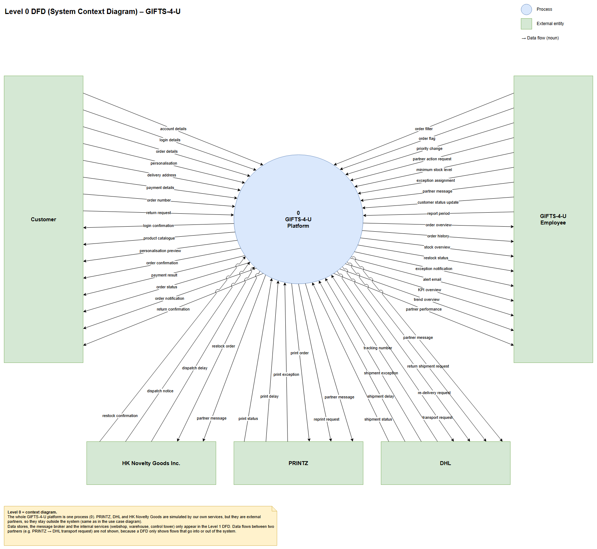

# Level 0 DFD

This Level 0 DFD (System Context Diagram) shows the GIFTS-4-U platform as one process and all data that goes into and out of it. Everything outside the process are external entities that send data to the system or receive data from it.

- **Customer**: sends account, login, order, personalisation, delivery address, payment and return data, and receives the product catalogue, a preview of the personalised product, the order confirmation, the payment result and the order status (Webshop FR001 – FR015).
- **GIFTS-4-U Employee**: works in the Control Tower. Sends filters, flags, priority changes, partner actions, exception assignments, messages and minimum stock levels, and receives order, stock, KPI, trend and partner overviews plus notifications and alert emails (Control Tower FR001 – FR030).
- **HK Novelty Goods Inc.**: the supplier. Receives restock orders and sends back a confirmation, a dispatch notice or a dispatch delay.
- **PRINTZ**: receives print orders and reprint requests, and sends the print status, delays and exceptions.
- **DHL**: receives transport requests, re-delivery requests and return shipment requests, and sends the shipment status, delays, exceptions and the tracking number.

The employee can send a message to every partner (Control Tower FR024), so each partner has a "partner message" flow.

PRINTZ, DHL and HK Novelty Goods are simulated by our own services, but they are still external partners, so they stay outside the system (the same as in the usecase diagram).

A Level 0 DFD has no data stores. The databases, the message broker and the internal services (webshop, warehouse and control tower) are shown in the Level 1 and Level 2 DFD. Flows between two partners (for example PRINTZ → DHL) are not drawn, because a DFD only shows data that goes into or out of the system.
