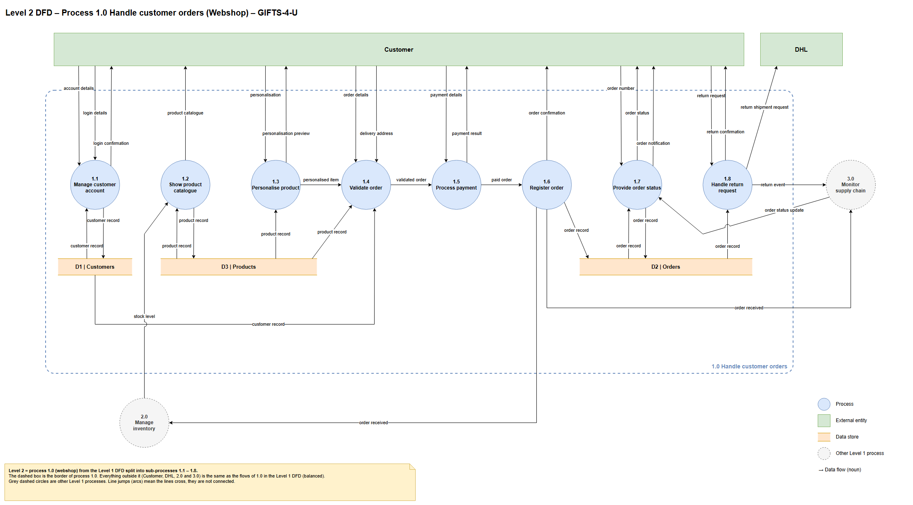
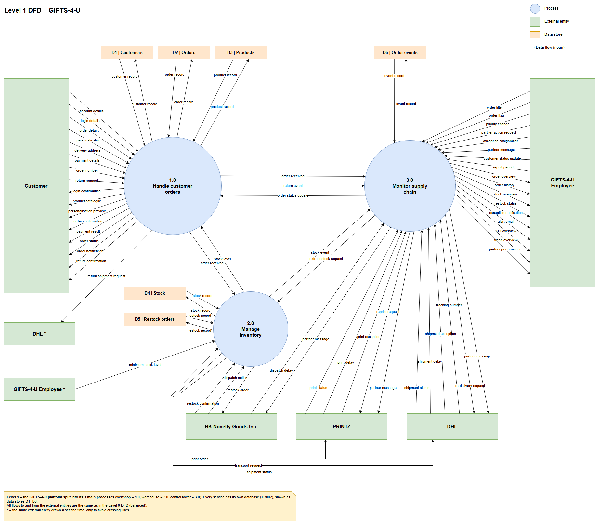

# Level 2 DFD

This Level 2 DFD zooms in on process **1.0 Handle customer orders** (the webshop). The process is split into 8 sub-processes, so you can see step by step what happens with the data of a customer order.

## Level 1 DFD (parent)

A Level 2 DFD always splits one process of the Level 1 DFD. That is why the Level 1 DFD is added as well, so you can see where process 1.0 comes from. At Level 1 the platform is split into its 3 main processes: 1.0 Handle customer orders (webshop), 2.0 Manage inventory (warehouse) and 3.0 Monitor supply chain (control tower). Every service has its own database (Control Tower TR002), shown as data stores D1 – D6.

## Sub-processes of 1.0

- **1.1 Manage customer account**: the customer creates an account and logs in (Webshop FR015).
- **1.2 Show product catalogue**: shows the products with their stock level from 2.0 (Webshop FR001, FR009).
- **1.3 Personalise product**: the customer adds a personalisation and sees a preview (Webshop FR003, FR013).
- **1.4 Validate order**: checks the order details and the delivery address (Webshop FR002, FR010).
- **1.5 Process payment**: simulated payment, including "payment failed" (Webshop FR008).
- **1.6 Register order**: saves the order and sends "order received" to 2.0 and 3.0 (Webshop FR004).
- **1.7 Provide order status**: the customer looks up the order status and gets notifications (Webshop FR011, FR014).
- **1.8 Handle return request**: handles a return and asks DHL for a return shipment (Webshop FR012).

## Notes

- The dashed box is the border of process 1.0. All flows that cross it are exactly the same as the flows of 1.0 in the Level 1 DFD, so the levels are balanced.
- The grey dashed circles (2.0 and 3.0) are other Level 1 processes. They are only drawn to show where the data goes.
- Line jumps (small arcs) mean that two lines cross. They are not connected.
