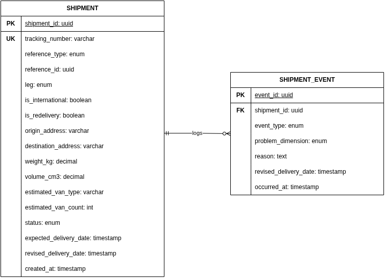
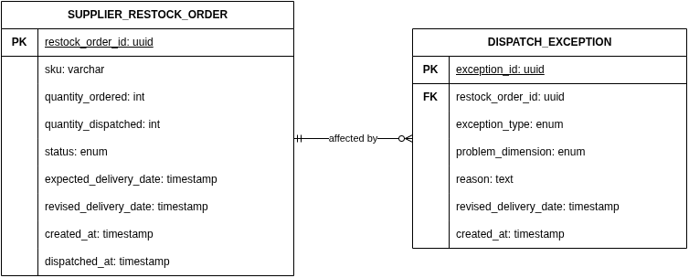

# Entity Relationship Diagrams

Each microservice has its own database (TR002 / TR003), so there is one ERD per service instead of one shared database. Services link data via shared IDs over RabbitMQ (`order_id`, `sku`, `restock_order_id`). `api-gateway-service` only routes requests and has no database.

Editable draw.io source: [`products/images/erd.drawio`](/products/images/erd.drawio)

## Overview

## Control Tower

Stores live order and stock read-models built from partner events, a 12-month event timeline (`event_id` prevents duplicate processing), separate exception and notification records so multiple issues on one order each get their own alert, plus partner actions and messages.

## Webshop

Handles accounts, the 6-SKU catalogue (with cached stock from Warehouse events), multi-item personalised orders, returns, and customer status notifications. `customer_id` on `ORDER` is nullable for guest order lookup.

## Warehouse

Tracks stock and reserved units per SKU (preventing negative stock and double reservations), physical store stock, seasonal thresholds for busy periods like Christmas, restock orders to Hong Kong, and idempotent stock movements for returns.

## PRINTZ

Manages the B2B-prioritised print queue, Control Tower reprint requests, daily print capacity, and simulated print exceptions.

## DHL

Tracks all three supply chain legs, return shipments, and re-deliveries by `tracking_number`, with size/weight for van estimation, an `is_international` flag for customs delays, and shipment events.

## Hong Kong Novelty Goods

Tracks incoming restock orders (2-week default lead time, partial deliveries via `quantity_dispatched`) and simulated dispatch delays.

## Outbox pattern

Each publishing service also keeps a local `OUTBOX_EVENT` table (included in `erd.drawio`) so events are not lost if RabbitMQ is temporarily down. Field and enum names will be synced with the API Message Design.
