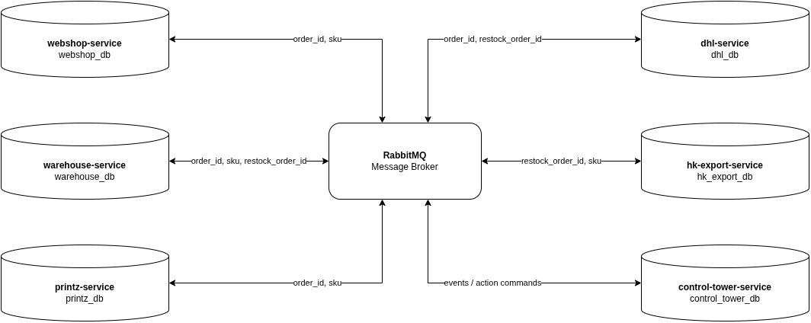
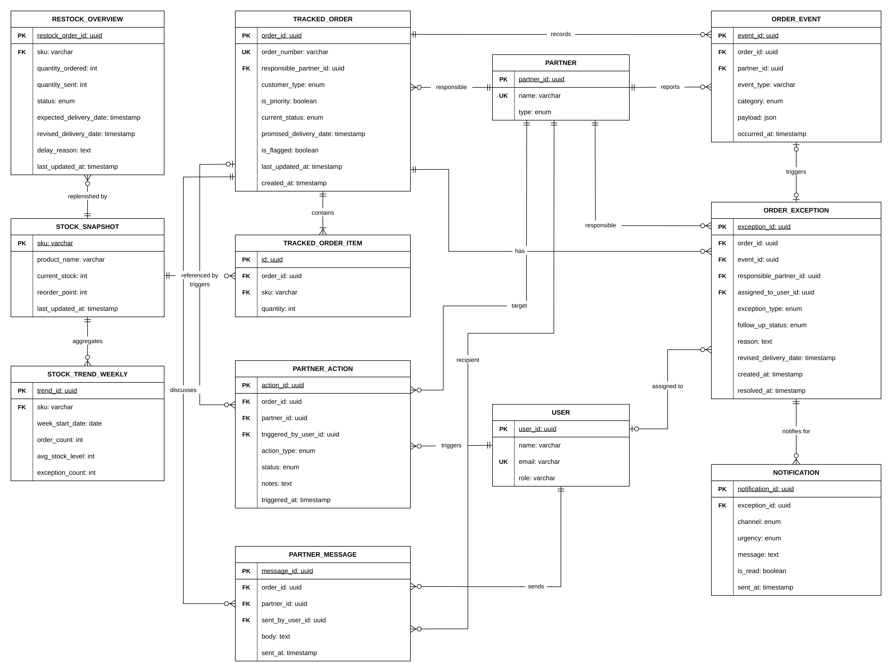
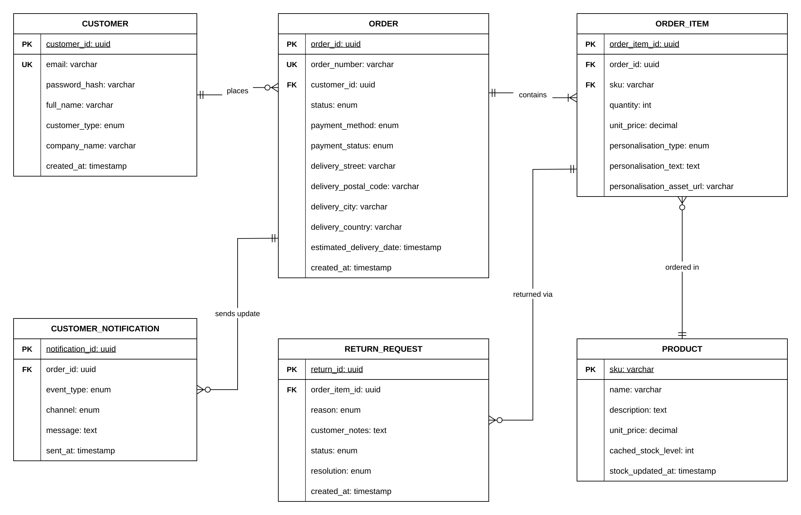
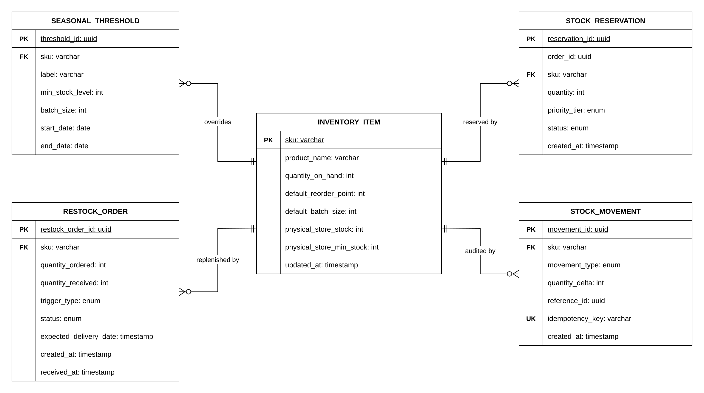
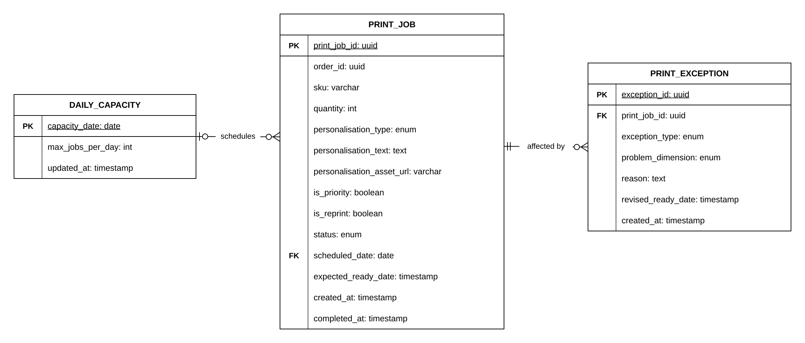

# Entity Relationship Diagrams

Each microservice has its own database (TR002 / TR003), so there is one ERD per service instead of one shared database. Services link data via shared IDs over RabbitMQ (`order_id`, `sku`, `restock_order_id`). `api-gateway-service` only routes requests and has no database.

Editable draw.io source: [`products/images/erd.drawio`](/products/images/erd.drawio)

## Overview

## Control Tower

Stores live order and stock read-models built from partner events, a 12-month event timeline (`event_id` prevents duplicate processing), normalized `PARTNER` and `USER` tables for traceability and exception assignment, plus partner actions and messages. `ORDER_EXCEPTION` links optionally (`0..1`) to `ORDER_EVENT` so manually flagged orders work too, and `NOTIFICATION` references `ORDER_EXCEPTION` directly. Derived flags like stock risk are calculated from `current_stock` and `reorder_point` instead of stored.

## Webshop

Handles customers (`password_hash` nullable for guest checkout), the 6-SKU catalogue with cached stock from Warehouse events, multi-item personalised orders, returns per order item, and customer notifications. Derived values like order total or out-of-stock delivery time are calculated in the service.

## Warehouse

Tracks stock per SKU, physical store stock, seasonal thresholds for busy periods like Christmas, priority reservations (reserved totals are derived from active `STOCK_RESERVATION` rows), restock orders to Hong Kong, and idempotent stock movements for returns.

## PRINTZ

Manages the B2B-prioritised print queue, Control Tower reprint requests, daily print capacity (`scheduled_date` is optional until a job is scheduled), and simulated print exceptions.

## DHL

Tracks all three supply chain legs, return shipments, and re-deliveries by `tracking_number`. Van estimates are calculated from `weight_kg` and `volume_cm3`, international customs checks use `origin_country` and `destination_country`, and revised delivery dates are logged on `SHIPMENT_EVENT`.

## Hong Kong Novelty Goods

Tracks incoming restock orders (2-week default lead time, partial deliveries via `quantity_dispatched`) and simulated dispatch delays with revised dates on `DISPATCH_EXCEPTION`.

## Outbox pattern

Each publishing service also keeps a local `OUTBOX_EVENT` table (included in `erd.drawio`) so events are not lost if RabbitMQ is temporarily down. Field and enum names will be synced with the API Message Design.
