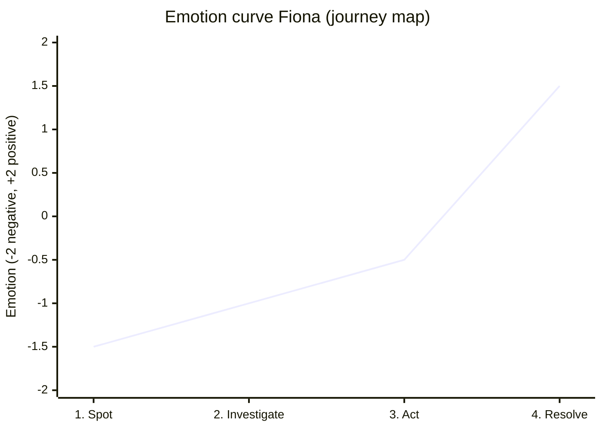

# Customer Journey Map — GIFTS-4-U Control Tower

Journey map for the primary persona **Fiona Koevoets** (Supply Chain Director), based on [persona.md](persona.md), the client briefing (Nov 2026), the Sprint 0 demo Q&A (16-11-2026) and the Control Tower requirements (`Requirements.xlsx`, sheet *Control Tower*).

| Persona | Scenario | User expectations |
|---|---|---|
| **Fiona Koevoets**, Supply Chain Director (GIFTS-4-U) | During the Christmas rush, a print machine breakdown at PRINTZ delays a **B2B priority order**. Fiona has to spot the problem, find out where the order is, act, and make sure it is still delivered on time. | Exceptions flash up straight away and are prioritised. She sees where an order is from one timeline, without calling DHL, PRINTZ or the warehouse. The system informs; she decides and acts. |

## Journey

| | Phase 1: Spot the exception | Phase 2: Investigate the order | Phase 3: Take action | Phase 4: Follow up & resolve |
|---|---|---|---|---|
| **Doing** | • Receives a notification about the delayed order (`FR020`) and an e-mail because a B2B priority order is affected (`FR019`). • Opens the Control Tower. • Sees the exception light up on the order (`FR004`, `FR006`), with PRINTZ as the responsible partner (`FR005`). • B2B priority orders are listed on top (`FR010`). | • Opens the affected order. • Reads the order timeline: every event with its time and the partner that reported it (`FR008`). • Sees the revised expected delivery date from PRINTZ (`FR014`). • Checks the order in the live overview, including the time of the last update (`FR001`). | • Compares the revised date with the promised delivery date. • Raises the priority of the order (`FR022`), so PRINTZ prints it before B2C jobs. • If the print job failed, requests a reprint at PRINTZ (`FR018`). • Flags the order, which sends an e-mail with the order number, the issue and the responsible partner (`FR017`). | • Follows up via the flag e-mail. • Watches the timeline update: printed, ready to ship, in transit (`FR003`, `FR008`). • Sees the exception disappear once the order is back on schedule and delivered on time. |
| **Thinking** | "What is going wrong right now?" "Which of these is most urgent?" | "Where exactly is this order?" "Is this status still up to date?" "Who is responsible?" | "Will the revised date still meet the promised delivery date?" "What can I do to get this order printed first?" | "Did my action actually work?" "Will the B2B customer get it on time?" |
| **Saying** | "Orders that go wrong must flash up straight away and be prioritised." | "I don't want to call DHL, PRINTZ and the warehouse to find one order." | "Put this priority order first and keep it on time." | "I want to know this is solved before the customer complains." |
| **Touchpoints** | • Notification and B2B e-mail • Control Tower overview • Exception on the order (animation, icon and label) | • Order detail page • Order timeline • Revised expected delivery date • Time of last update and responsible partner | • Order priority setting • Reprint action (if needed) • Flag order → e-mail | • Flag e-mail • Order timeline (updated) • Overview without the exception |
| **Emotions** | **Concerned, annoyed** • Something went wrong: a B2B priority order is at risk. • Glad she sees it herself instead of hearing it from a customer, but the situation is still negative. | **Concerned, focused** • The problem is still there, but she now understands what happened and who is responsible. • Doubts the data if the last update is old. | **Determined, in control** • She decides and acts herself, which gives her grip on the situation. • The order is still delayed until PRINTZ is printing again. | **Relieved and satisfied** • The order is back on track and delivered on time. • Satisfied the customer never noticed. |
| **Pain points** | • Today: partners do not report delays, so she hears about it from customer complaints. • Too many exceptions at once without priority. | • Today: she has to contact every company individually to find one order. • Data may be outdated. | • No direct control over PRINTZ: she can only set priorities and request actions. • The revised date may exceed the standard 6-day delivery time. | • No clear sign that an action actually worked. • Easy to lose track of follow-ups without the flag e-mail. |

## Insights

1. **Urgent first:** Fiona's day starts with "what is going wrong right now". Exceptions must show up on the affected order and light up by themselves (`FR004`, `FR006`). She is notified straight away (`FR019`, `FR020`), and B2B priority orders are listed on top (`FR010`).
2. **One source of truth:** one live overview and one order timeline, with the time of each event and the reporting partner, replace calling every partner (`FR001`, `FR008`). The data is consistent with the partner services and updated within 5 seconds, which builds trust (`NFR001`, `NFR003`).
3. **Inform, don't decide:** the system shows the facts, such as the revised delivery date (`FR014`), and offers actions: change the priority, request a reprint, flag the order (`FR022`, `FR018`, `FR017`). Fiona makes the decision.
4. **Accessible alerts:** exceptions light up with a subtle animation, but never rely on colour alone. There is always an icon or label as well (`FR006`, `NFR008`).

## Internal ownership

- **Developers:** showing exceptions on the order with the responsible partner, notifications and B2B e-mails, the live overview and order timeline, revised delivery dates, priority changes, reprint requests and flag e-mails.
- **UX/UI designer:** a prioritised overview with B2B on top, a clear timeline, a subtle animation, never colour alone (icon + label), clear actions.
- **Integration / partners:** reliable, consistent events from DHL, PRINTZ, the warehouse and Hong Kong Novelty Goods, within 5 seconds, so the Control Tower data stays trustworthy.

## Emotion curve

The curve stays **below zero as long as the problem exists**. Being in control changes how Fiona handles the exception, but not the fact that something went wrong and an order is delayed. It only becomes positive once the order is back on track. The Control Tower makes the negative part shorter and less chaotic; it does not make a problem feel positive.

| Phase | Emotion | Level | Quote |
|---|---|---|---|
| 1. Spot the exception | Concerned, annoyed | Negative (-1.5) | "What is going wrong right now?" |
| 2. Investigate the order | Concerned, focused | Negative (-1) | "I don't want to call every partner for one order." |
| 3. Take action | Determined, in control | Slightly negative (-0.5) | "Put this priority order first and keep it on time." |
| 4. Follow up & resolve | Relieved and satisfied | Positive (+1.5) | "Solved before the customer complains." |

> **Note:** the scenario (print machine breakdown at PRINTZ during the Christmas rush) and the emotions per phase are a team interpretation of the persona and briefing, not stated directly by Fiona. Validate them with her at the next demo.

## Research traceability

All requirement codes refer to the **Control Tower** sheet in `Requirements.xlsx`.

| Code | Requirement | Used in |
|---|---|---|
| `FR001` | Live overview of all open orders, incl. time of last update and responsible partner | Phase 2, insight 2 |
| `FR003` | Every order status represents a happy flow event | Phase 4 |
| `FR004` | Exceptions are shown on the affected order | Phase 1, insight 1 |
| `FR005` | Exceptions always mention the responsible partner | Phase 1 |
| `FR006` | Exceptions subtly light up with an animation | Phase 1, insights 1 and 4 |
| `FR008` | Order timeline with the time of each event and the reporting partner | Phases 2 and 4, insight 2 |
| `FR010` | B2B priority orders are visibly marked and listed above B2C orders | Phase 1, insight 1 |
| `FR014` | PRINTZ delay: affected orders with their revised expected delivery date | Phase 2, insight 3 |
| `FR017` | Flagging an order sends an e-mail with the order number, issue and responsible partner | Phases 3 and 4, insight 3 |
| `FR018` | Trigger actions in partner services (e.g. reprint request to PRINTZ) | Phase 3, insight 3 |
| `FR019` | E-mail when a problem affects a B2B priority order | Phase 1, insight 1 |
| `FR020` | Notification when an order is delayed, out of stock or goes wrong | Phase 1, insight 1 |
| `FR022` | The employee can change the priority of an order | Phase 3, insight 3 |
| `NFR001` | Data is consistent with the partner services | Insight 2 |
| `NFR003` | A status change is shown within 5 seconds | Insight 2 |
| `NFR008` | Statuses and exceptions never rely on colour alone | Insight 4 |

Other sources:

- **Scenario and expectations:** client briefing (Christmas rush, B2B priority), Sprint 0 demo Q&A (urgent exceptions first), persona key tasks.
- **Pain points:** client briefing, Supply Chain Notes, Week 0 problem flow (partners not reporting delays, contacting every company individually).
- **Constraints:** `Projectplan.md` and client briefing (6-day delivery, no control over partners).
