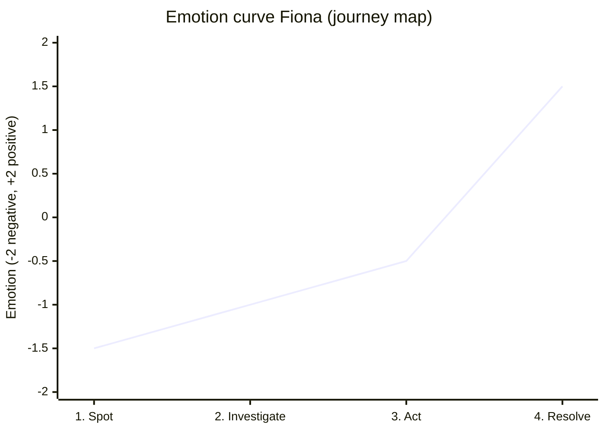

# Customer Journey Map — GIFTS-4-U Control Tower

Journey map for the primary persona **Fiona Koevoets** (Supply Chain Director), based on [persona.md](persona.md), the client briefing (Nov 2026), the Sprint 0 demo Q&A (16-11-2026) and the Control Tower requirements.

| Persona | Scenario | User expectations |
|---|---|---|
| **Fiona Koevoets**, Supply Chain Director (GIFTS-4-U) | During the Christmas rush, a print breakdown at PRINTZ puts a **B2B priority order** at risk. Fiona has to spot the problem, find out where the order is, act, and make sure it is still delivered on time. | Exceptions flash up straight away and are prioritised. She sees where an order is from one timeline, without calling DHL, PRINTZ or the warehouse. The system informs; she decides and acts. |

## Journey

| | Phase 1: Spot the exception | Phase 2: Investigate the order | Phase 3: Take action | Phase 4: Follow up & resolve |
|---|---|---|---|---|
| **Doing** | • Opens the Control Tower at the start of the day. • First checks what is going wrong right now. • Sees a flashing exception: print breakdown at PRINTZ, B2B priority order affected. | • Opens the affected order. • Reads the order timeline: warehouse → PRINTZ → DHL. • Checks the status each partner reported and the time of the last update. • Sees who is responsible. | • Requests a reprint at another moment or partner. • Checks stock and requests an extra restock if needed. • Flags the order, which sends her an e-mail. | • Opens the order again via the flag e-mail. • Checks that the reprint and DHL delivery are on track. • Sees the exception disappear once the order is back on schedule. |
| **Thinking** | "What is going wrong right now?" "Which of these is most urgent?" | "Where exactly is this order?" "Is this status still up to date?" "Who do I need to call?" | "What is the fastest way to still deliver in time?" "Is there enough stock to reprint?" | "Did my action actually work?" "Will the B2B customer get it on time?" |
| **Saying** | "Orders that go wrong must flash up straight away and be prioritised." | "I don't want to call DHL, PRINTZ and the warehouse to find one order." | "Request a reprint and keep this priority order on time." | "I want to know this is solved before the customer complains." |
| **Touchpoints** | • Control Tower overview • Exception list (prioritised) • Flashing alert with icon and label | • Order detail page • Order timeline • Partner status + last-update time • Responsible party | • Action buttons: reprint, re-delivery, extra restock • Stock overview • Flag order → e-mail | • Flag e-mail • Order timeline (updated) • Exception list (cleared) |
| **Emotions** | **Concerned, annoyed** • Something went wrong: a B2B priority order is at risk. • Glad she sees it herself instead of hearing it from a customer, but the situation is still negative. | **Concerned, focused** • The problem is still there, but she now understands what happened and who is responsible. • Doubts the data if the last update is old. | **Determined, in control** • She decides and acts herself, which gives her grip on the situation. • The order is still delayed until the action works (6-day delivery, 2 weeks restock from Hong Kong). | **Relieved and satisfied** • The order is back on track and delivered on time. • Satisfied the customer never noticed. |
| **Pain points** | • Today: partners do not report delays, so she hears about it from customer complaints. • Too many exceptions at once without priority. | • Today: she has to contact every company individually to find one order. • No direct control over DHL, PRINTZ or Hong Kong Novelty Goods. • Data may be outdated. | • Stock is counted by hand and e-mailed in Excel, so typos and wrong order numbers happen. • Restock from Hong Kong takes 2 weeks. | • No clear sign that an action actually worked. • Easy to lose track of follow-ups without the flag e-mail. |

## Insights

1. **Urgent first:** Fiona's day starts with "what is going wrong right now". Exceptions must flash up on their own and be sorted by priority, with B2B priority orders on top (`FR004`, `FR005`, `FR006`).
2. **One source of truth:** one order timeline with the partner-reported status and the time of the last update replaces calling every partner and builds trust in the data (`FR001`, `FR008`, `NFR001`).
3. **Inform, don't decide:** the system shows the facts and offers actions (reprint, re-delivery, extra restock), but Fiona makes the decision. Flagging with an e-mail lets her follow up (`FR018`).
4. **Accessible alerts:** exceptions use clear colour differences and a subtle animation, but never colour alone. There is always an icon or label as well (`FR006`, `NFR008`).

## Internal ownership

- **Developers:** exception detection and prioritisation, the order timeline, partner status integration with last-update time, actions (reprint, re-delivery, restock), flag e-mails.
- **UX/UI designer:** prioritised exception overview, a clear timeline, subtle animation, never colour alone (icon + label), clear action buttons.
- **Integration / partners:** reliable status updates from DHL, PRINTZ, the warehouse and Hong Kong Novelty Goods, so the Control Tower data stays trustworthy.

## Emotion curve

The curve stays **below zero as long as the problem exists**. Being in control changes how Fiona handles the exception, but not the fact that something went wrong and an order is delayed. It only becomes positive once the order is back on track. The Control Tower makes the negative part shorter and less chaotic; it does not make a problem feel positive.

| Phase | Emotion | Level | Quote |
|---|---|---|---|
| 1. Spot the exception | Concerned, annoyed | Negative (-1.5) | "What is going wrong right now?" |
| 2. Investigate the order | Concerned, focused | Negative (-1) | "I don't want to call every partner for one order." |
| 3. Take action | Determined, in control | Slightly negative (-0.5) | "Request a reprint and keep this priority order on time." |
| 4. Follow up & resolve | Relieved and satisfied | Positive (+1.5) | "Solved before the customer complains." |

> **Note:** the scenario (print breakdown at PRINTZ during the Christmas rush) and the emotions per phase are a team interpretation of the persona and briefing, not stated directly by Fiona. Validate them with her at the next demo.

## Research traceability

- **Scenario and expectations:** client briefing (Christmas rush, B2B priority), Sprint 0 demo Q&A (urgent exceptions first), persona key tasks.
- **Doing / touchpoints:** `FR001`, `FR004`, `FR005`, `FR006`, `FR008`, `FR018`, `NFR001`, `NFR008`.
- **Pain points:** client briefing, Supply Chain Notes, Week 0 problem flow (manual stock counts in Excel, partners not reporting delays, contacting every company individually).
- **Constraints:** `Projectplan.md` and client briefing (6-day delivery, 2 weeks restock from Hong Kong, no control over partners).
