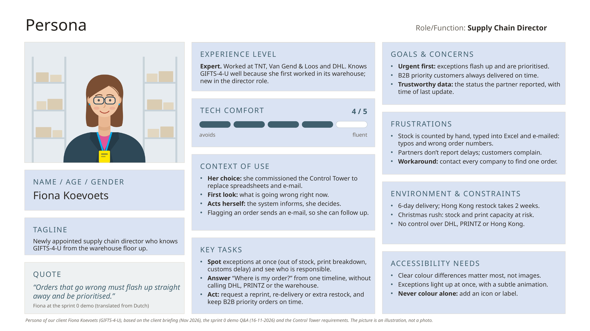

# Persona — GIFTS-4-U Control Tower

Primary persona for the GIFTS-4-U Control Tower, representing our client **Fiona Koevoets** based on the client briefing (Nov 2026), the Sprint 0 demo Q&A (16-11-2026), and the Control Tower requirements.

## Persona Overview

## Profile

| Field | Details |
|---|---|
| **Name** | Fiona Koevoets |
| **Role / Function** | Supply Chain Director (GIFTS-4-U) |
| **Tagline** | Newly appointed supply chain director who knows GIFTS-4-U from the warehouse floor up. |
| **Experience Level** | Expert. Worked at TNT, Van Gend & Loos, and DHL. Knows GIFTS-4-U well because she first worked in its warehouse; new in the director role. |
| **Tech Comfort** | **4 / 5** (towards *fluent* — team estimate, not stated directly by Fiona) |

## Quote

> *"Orders that go wrong must flash up straight away and be prioritised."*
> — Fiona at the Sprint 0 demo (translated from Dutch: *"De excepties, orders die fout gaan moeten gelijk opflashen en geprioriseerd worden."*)

## Context of Use

- **Her choice:** She commissioned the Control Tower to replace spreadsheets and e-mail.
- **First look:** Immediately checks what is going wrong right now.
- **Acts herself:** The system informs, she decides.
- **Follow-up:** Flagging an order sends an e-mail so she can follow up directly.

## Key Tasks

- **Spot exceptions at once** (out of stock, print breakdown, customs delay) and see who is responsible (`FR004`, `FR005`).
- **Answer "Where is my order?"** from one timeline, without calling DHL, PRINTZ, or the warehouse (`FR008`).
- **Act:** request a reprint, re-delivery, or extra restock, and keep B2B priority orders on time (`FR018`).

## Goals & Concerns

- **Urgent first:** Exceptions flash up and are prioritised.
- **B2B priority:** B2B priority customers are always delivered on time.
- **Trustworthy data:** Shows the status the partner reported, with the time of the last update (`FR001`, `NFR001`).

## Frustrations

- Stock is counted by hand, typed into Excel, and e-mailed — causing typos and wrong order numbers.
- Partners do not report delays; customers complain.
- Current workaround: contacting every company individually to find one order.

## Environment & Constraints

- **Delivery lead times:** 6-day delivery; Hong Kong restock takes 2 weeks.
- **Peak periods:** Christmas rush puts stock and print capacity at risk.
- **Partner boundaries:** No direct control over DHL, PRINTZ, or Hong Kong Novelty Goods.

## Accessibility Needs

- Clear colour differences matter most, not images (Sprint 0 demo Q&A).
- Exceptions light up at once, with a subtle animation (`FR006`).
- Never rely on colour alone: add an icon or label (`NFR008`).

## Research Traceability

Everything in this persona is grounded in our project research:

- **Role, tagline, and experience:** Client briefing (new director of SCM; worked at TNT, Van Gend & Loos, and DHL; first worked in the GIFTS-4-U warehouse).
- **Quote:** Fiona at the Sprint 0 demo (translated from Dutch).
- **Tech comfort (4 / 5):** Team estimate, not stated directly by Fiona.
- **Context of use and goals:** Client briefing (Fiona is the client, takes action herself, flagging sends an e-mail, B2B priority), Sprint 0 demo Q&A (urgent exceptions first), `FR001`, and `NFR001`.
- **Frustrations:** Client briefing, Supply Chain Notes, and the Week 0 problem flow.
- **Environment & constraints:** `Projectplan.md` and client briefing (6-day delivery, 2 weeks from Hong Kong, Christmas rush scenario).
- **Key tasks:** `FR004`, `FR005`, `FR008`, and `FR018`.
- **Accessibility needs:** Sprint 0 demo Q&A (colour matters more than images), `FR006` (subtle animation), and `NFR008` (team requirement: never colour alone).
