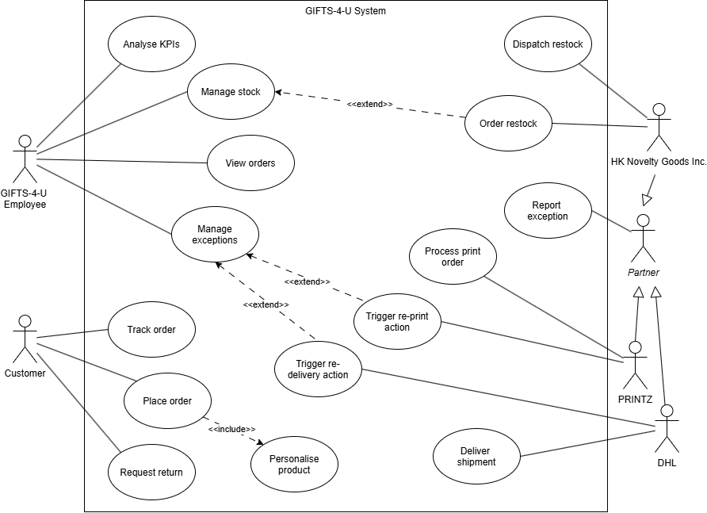

# Usecase Diagram

This usecase diagram shows what the GIFTS-4-U system does and who uses it. Everything inside the box are functions of the system, and everything outside the box are actors that use it.

- **Customer**: places an order, personalises the product, tracks the order and can request a return.
- **GIFTS-4-U Employee**: manages stock, views orders, analyses KPIs and handles exceptions (for example a failed print or a failed delivery).
- **HK Novelty Goods Inc.**: the supplier. It receives restock orders and dispatches the restock.
- **PRINTZ**: processes the print orders and carries out re-prints.
- **DHL**: delivers the shipments and carries out re-deliveries.

The internal actors (Customer and Employee) are on the left and the external partners are on the right. This makes it easy to see which parts of the process happen at GIFTS-4-U and which parts are done by partners.

HK Novelty Goods Inc., PRINTZ and DHL all inherit from an abstract _Partner_ actor. All three can report an exception, so instead of drawing three separate lines to "Report exception" there is one line from Partner. This keeps the diagram cleaner.

Every order is a personalised product, so "Personalise product" is always part of "Place order". That is why we used include.

Since the employee can still reorder stock on busier periods manually, the usecase was left in the diagram and not seen as an automatic system function (like re-ordering below a threshold).

When an exception comes in, the employee decides what to do. Only in some cases this leads to a re-print or a re-delivery, so those are extensions of "Manage exceptions". The actual action is then done by PRINTZ or DHL.
