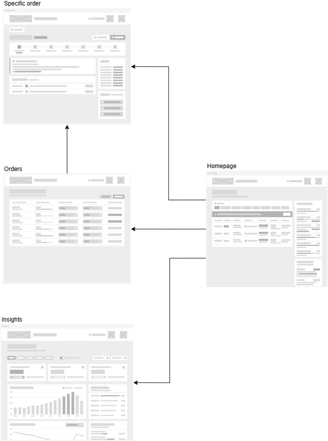

# Wireflow

The wireflows show how the wireframes connect and which paths a user can take through the Control Tower and the Webshop.

## Control Tower

The homepage is the starting point and links to the orders overview, a specific order and the insights page. Employees can open a specific order straight from the homepage or go through the orders overview first.  
This gives both a fast and a complete route to the same information. All pages share the same header, so the structure stays consistent.

## Webshop

The homepage is the center of the webshop. From here the user can browse products, log in or register, or look up an order.

The main path goes from the products page to a specific product, the cart and the checkout. After the checkout the system checks whether the payment succeeded. On success the order confirmed popup is shown and the user can choose to go to their order or return to the homepage. On failure the payment failed popup is shown and the user can try again, which leads back to the checkout, or go back to the homepage. This way the user is never stuck after an error.

A user who has an account, logs in and lands on the account page. A user without an account registers and is sent to the homepage. Customers can also use the order lookup to open order tracking without an account. From the account page or order tracking the user can start a return request, which ends in a confirmation that the return was requested.
