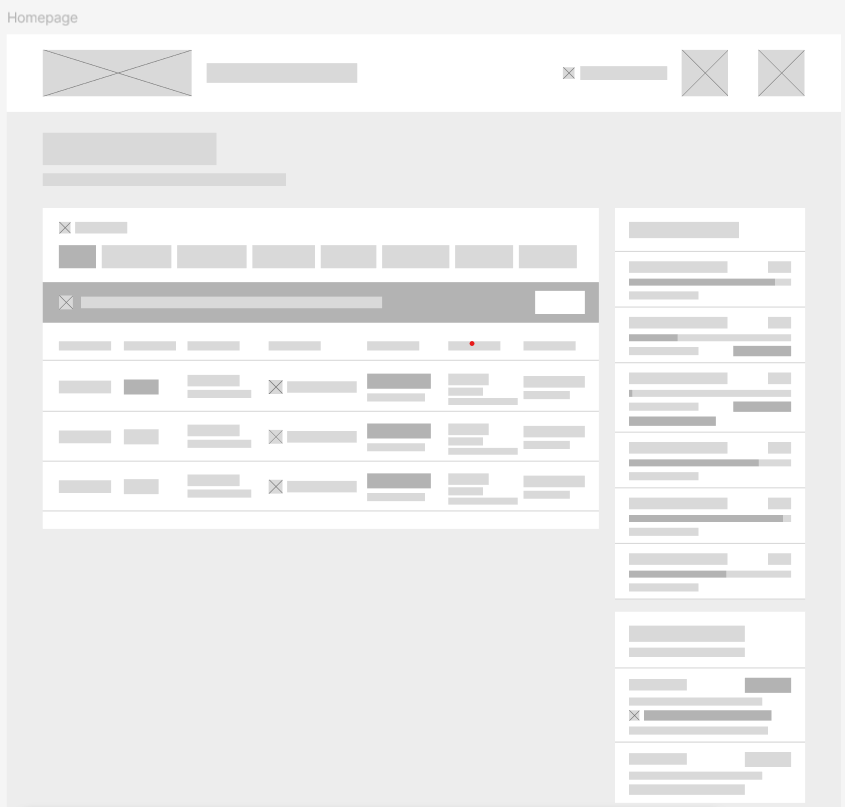
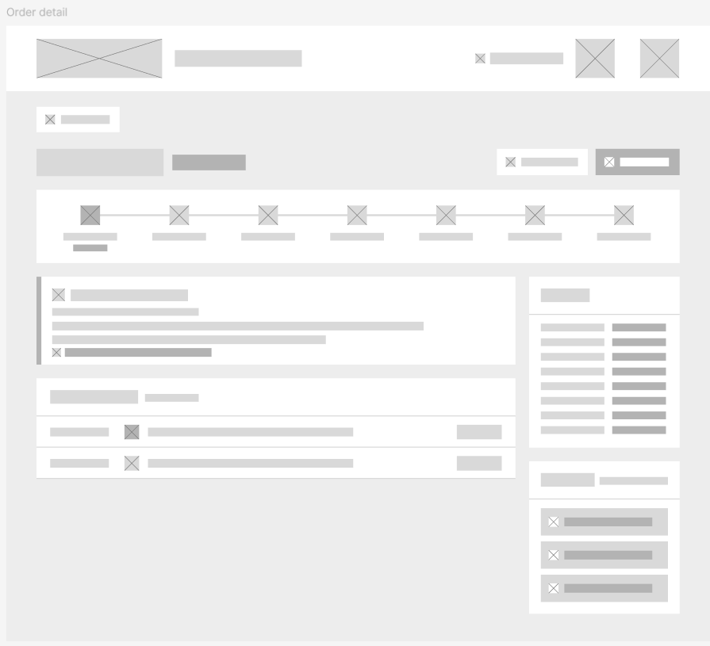
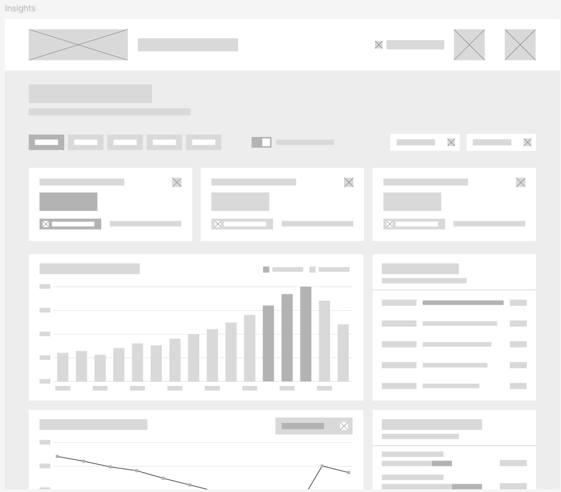
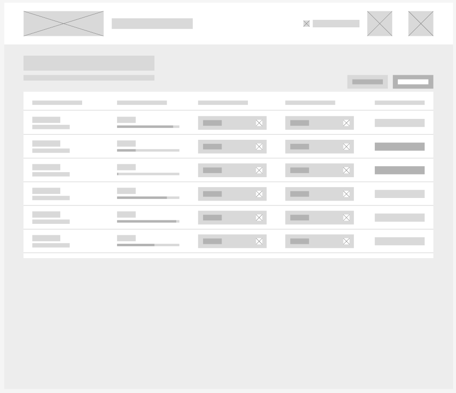
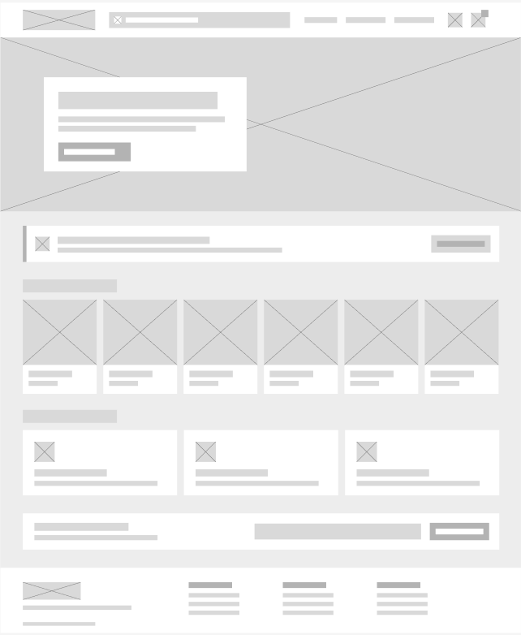
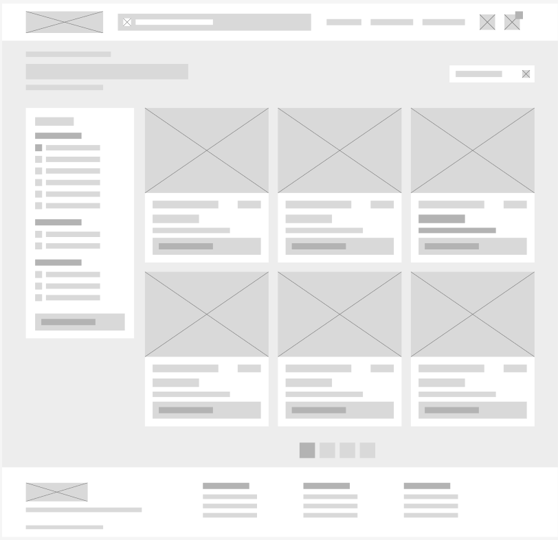
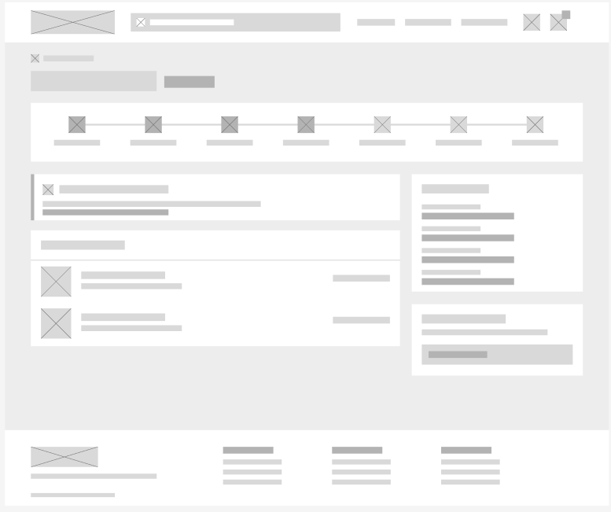
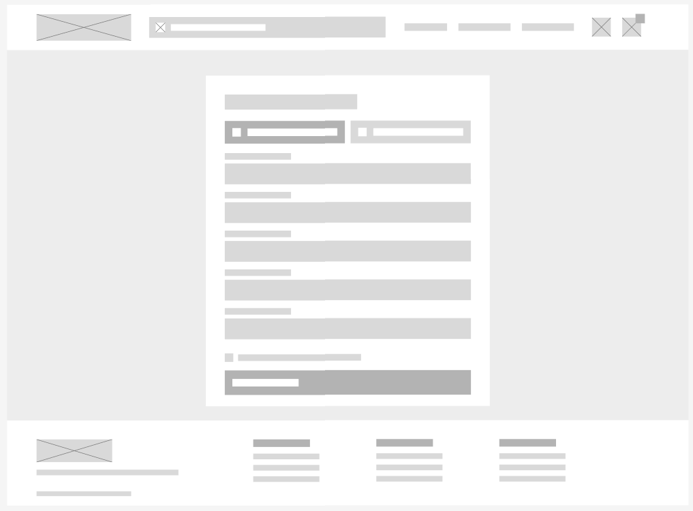
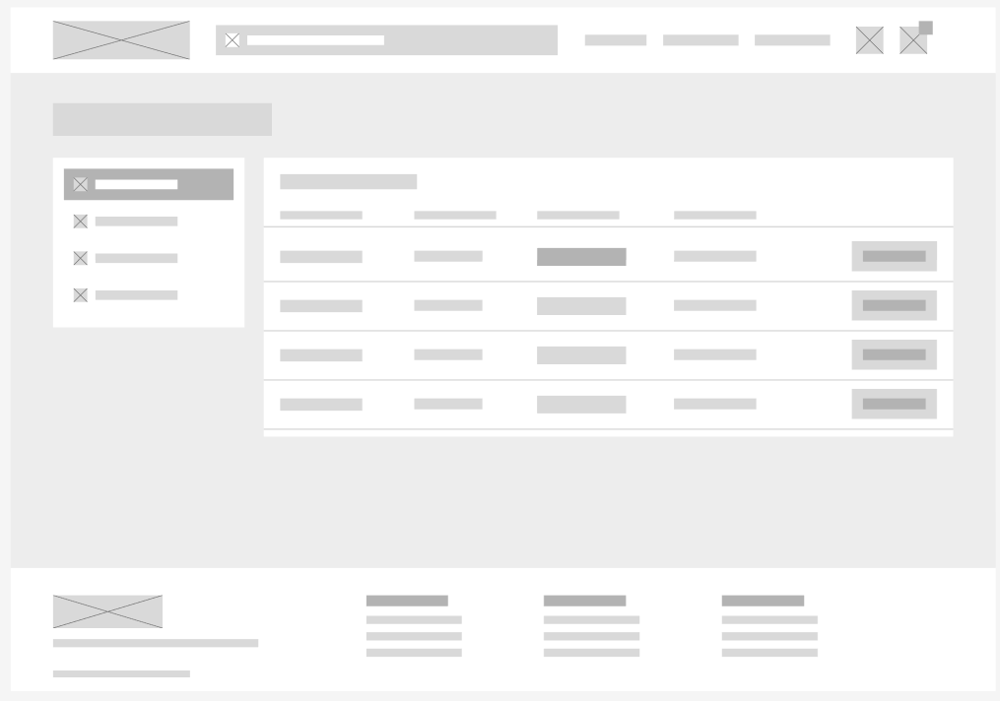

# Wireframes

Wireframes have been made to lay out the structure of the most important frontend pages.

The wireframes are low fidelity, replacing images with crosses and not containing text. These will be included in the high fidelity prototype.

Throughout the wireframes Nielsen's heuristics were kept in mind. And all the choices related to content are based directly from the requirements list.

## Control Tower

The Control Tower is the main place for the employee's of GIFTS-4-U to get more information about orders. They will be the primary user.

The homepage shows an overview of all orders in a table, with status filters and a search bar to quickly search a specific order. On the right, a sidebar lists inventory stock levels and below this the orders from Honk Kong Novelty Goods are listed with their status. This page is where a user starts their day and picks which order to open.

We chose to include these components with information in the same place, rather than make seperate pages, so that the user can see all important information with as few clicks as possible.

The order details page shows a single order with a progress tracker that lays out every step of its journey. Below the tracker, a highlighted notice showing possible exceptions for that specific order. Order products are below it and customer details are on the right. Under that is an actions block where users can take actions like re-requesting print or extra restock order.

The insights page gives an overview of the numbers through filters, three KPI cards, a bar chart and a line chart. These will contain orders per period and KPI levels per period. Next to the charts are the busiest weeks in that period and under that are the delays and errors per company. The filters at the top let the user change the period and focus of everything on the page.

The threshold manager lists every threshold in a table, with the ability to change the threshold and batch size for the automatic re-ordering system. Eventually colors will highlight the ones that are below a threshold at this moment.
A reset and save button can be found at the top right of the table.

## Webshop

The homepage opens with a large hero banner and a call to action button. Below it is an announcement bar for giving B2B customers a guarantee for delivery time. Under that a row of product cards and a set of short info blocks for explaining the steps. The page ends with an order tracker search bar and the footer.

The products page shows all products in a grid of cards, with a sorting dropdown in the top right. A filter sidebar on the left lets the user narrow down the products by category. Page numbers below the grid are used to move through the results.

The product details page has a large image with thumbnails on the left, and the title, price and a notice on the right. The user can choose an for adding customization, like a title or image and set a quantity and add the product to their cart. A description of the product is placed under the images.

The cart lists every product with its image, quantity controls, price and a remove button. A summary block on the right shows the totals and the button that leads to the checkout. A highlighted line in an item marks a warning for that product.

The checkout is a single page with a choice for B2C or B2B at the top, a form for the customer details and a list of payment methods. The order summary stays visible on the right with the products and the total. The pay button is placed at the bottom of this summary.

The payment failed popup is shown in the center of the page when a payment does not go through. It explains what happened with an icon, a title and a short message. Two buttons let the user try again or go back.

This popup is in line with the error prevention and recognizing errors heuristic. It explains what happened and gives users two clear choices.

The order confirmed popup is shown after a successful payment, using the same layout as the payment failed popup. It contains an icon, a title, a short message and the order number. Two buttons let the user view their order or keep shopping.

The order lookup lets a customer find an order without logging in. They fill in two fields and press a single button to search. The form is centered in a card to keep the page simple.

The order details page shows the progress of an order in a tracker, with a notice and the ordered products below it. A sidebar on the right contains the order information. Under that is a block with a button to start a return.

The return request page lets the user select which products from the order they want to return. Below that, they choose a reason from a list and can add extra information in a text box. A summary block on the right holds the button that sends the request.

The login page is a small centered card with two input fields and a login button. A divider below the button separates it from a link for new customers. This keeps the page focused on a single task.

The register page is a centered card with a switch at the top for declaring B2C or B2B customers (Private or Business). and a form of five input fields. A checkbox and a register button are placed at the bottom of the form. The layout matches the login page so both feel like the same flow.

Because the login and register page share a layout, this is in line with the consistency and standards heuristic. 

The account page has a menu on the left to switch between the different account sections like orders, personal information or a logout button. The main area shows a table of the customer's orders with their status. Each row has a button to open that order.
